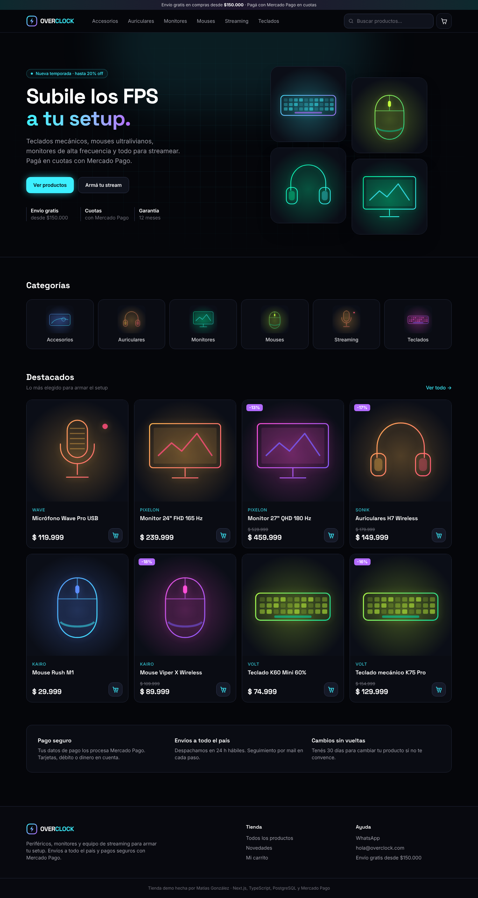
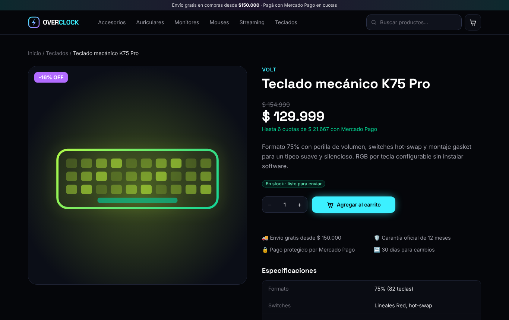
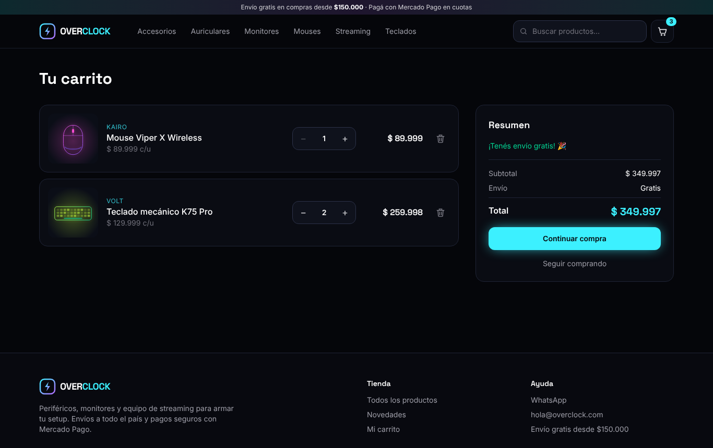
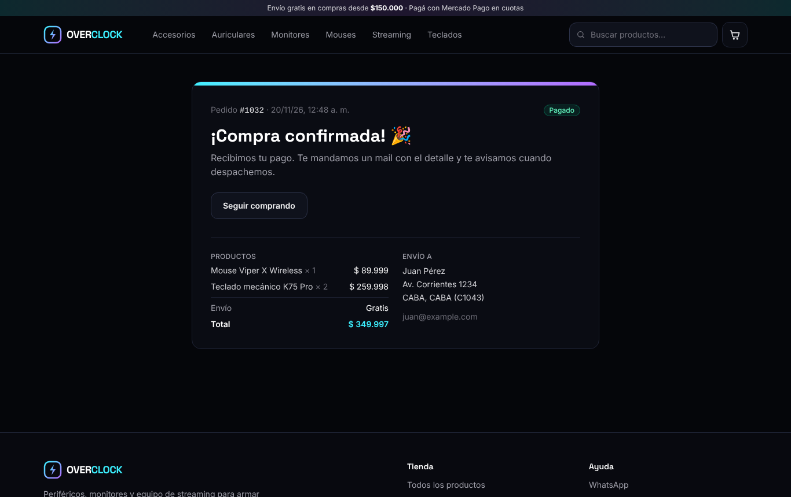
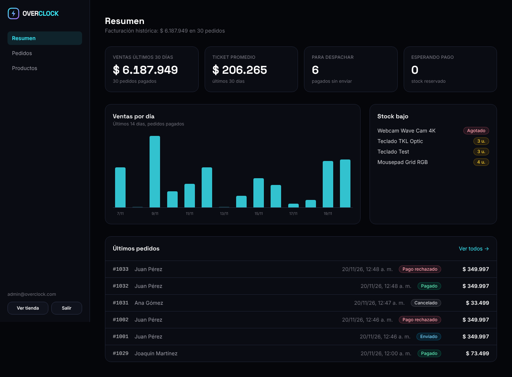
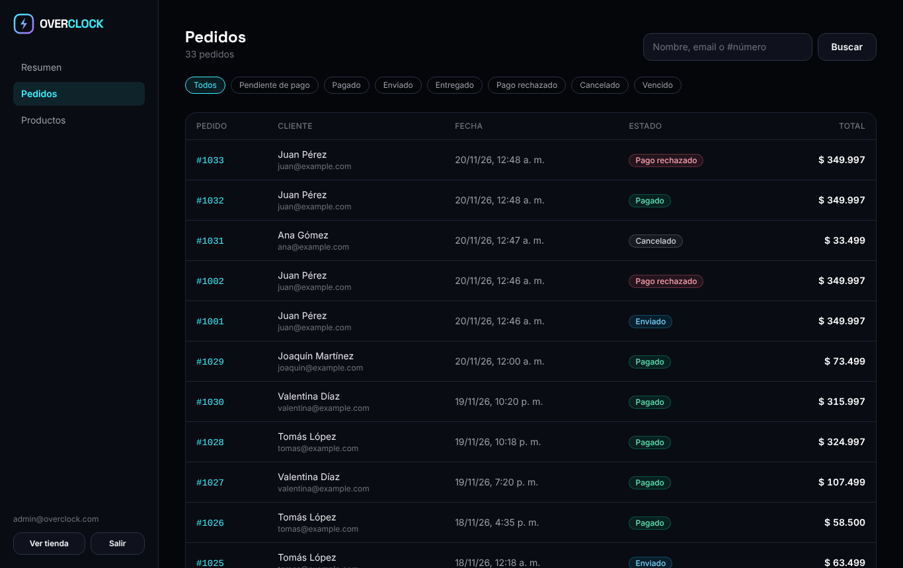
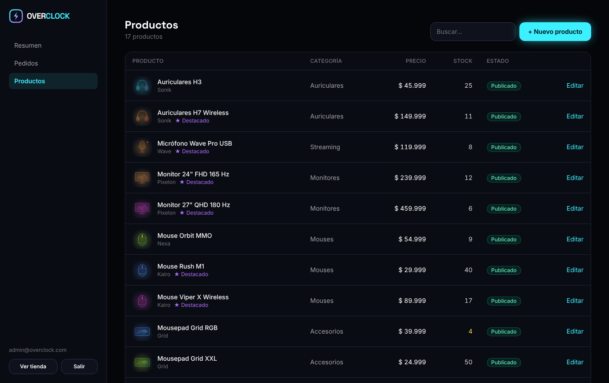

# ⚡ Overclock — Tienda online gamer con Mercado Pago

E-commerce full-stack de periféricos gamer: catálogo con filtros, carrito, checkout con **Mercado Pago (Checkout Pro)**, confirmación de pagos por **webhooks**, **panel de administración** y **mails** automáticos.



## Funcionalidades

**Tienda**
- Catálogo con categorías, búsqueda, orden por precio y filtro "solo con stock"
- Detalle de producto con especificaciones, descuentos y cuotas
- Carrito persistente (sobrevive a recargas), que al abrirse se sincroniza con el precio y el stock reales
- Envío gratis desde un monto configurable, con barra de progreso
- Checkout con validación en el servidor (DNI, código postal, provincias argentinas)
- Página de estado del pedido (pagado, pendiente, rechazado, vencido)

**Pagos**
- Mercado Pago Checkout Pro (preferencias, `external_reference`, `back_urls`)
- Webhook con **verificación de firma HMAC** (`x-signature`), idempotente
- El estado del pago siempre se consulta en la API de Mercado Pago (nunca se confía en el navegador)
- El **stock se reserva** al iniciar el pago y se libera solo si el pago se rechaza o pasan 30 minutos
- Se valida que el monto pagado coincida con el total del pedido
- **Modo demo**: un simulador de pago propio para probar todo sin cuenta de Mercado Pago

**Panel de admin** (`/admin`)
- Login con JWT en cookie httpOnly, límite de intentos y rutas protegidas (proxy + verificación en el servidor)
- Resumen: ventas de 30 días, ticket promedio, gráfico de ventas por día, alertas de stock bajo
- Pedidos: filtros por estado, búsqueda, detalle y cambio de estado (enviado / entregado / cancelado)
- Productos: alta, edición, publicar u ocultar, destacados y especificaciones

**Mails**: confirmación de compra al cliente, aviso de venta a la tienda, aviso de envío y de pago rechazado.

## Stack

| Capa | Tecnología |
|---|---|
| Framework | Next.js 16 (App Router, Server Components, Server Actions) |
| Lenguaje | TypeScript |
| Estilos | Tailwind CSS 4 |
| Base de datos | PostgreSQL + Drizzle ORM |
| Pagos | SDK oficial de Mercado Pago |
| Validación | Zod |
| Estado del carrito | Zustand (persistido en localStorage) |
| Auth | jose (JWT) + bcrypt |
| Mails | Nodemailer (SMTP) |

## Cómo correrlo en tu PC (Windows)

### 1. Requisitos
- **Node.js 20 o superior** → https://nodejs.org (versión LTS)
- **Una base PostgreSQL.** Lo más fácil es **Neon** (gratis, no hay que instalar nada):
  1. Creá una cuenta en https://neon.tech y un proyecto nuevo.
  2. Copiá la *connection string* (empieza con `postgresql://...`).

### 2. Instalar
Abrí la carpeta del proyecto en Antigravity y, en la terminal:

```powershell
npm install
copy .env.example .env
```

Editá `.env` y pegá tu connection string en `DATABASE_URL`. Cambiá también `AUTH_SECRET` por una clave aleatoria:

```powershell
node -e "console.log(require('crypto').randomBytes(32).toString('hex'))"
```

### 3. Crear las tablas y cargar productos
```powershell
npm run db:push          # crea las tablas
npm run db:seed          # carga categorías, productos y el usuario admin
npm run db:demo-orders   # (opcional) ventas de ejemplo para que el panel tenga datos
```

### 4. Levantar
```powershell
npm run dev
```
- Tienda: http://localhost:3000
- Panel: http://localhost:3000/admin → `admin@overclock.com` / `Admin123!` (se cambian en `.env` antes del seed)

Con `PAYMENTS_MODE="demo"` el botón de pagar te lleva a un **simulador** donde elegís aprobar o rechazar el pago.

## Activar Mercado Pago (credenciales de prueba)

1. Entrá a https://www.mercadopago.com.ar/developers/panel/app y creá una aplicación (*Pagos online → Checkout Pro*).
2. En **Cuentas de prueba**, creá un usuario **vendedor** y uno **comprador**.
3. Iniciá sesión con el vendedor de prueba, abrí su aplicación y copiá el **Access Token de producción** de esa cuenta de prueba (empieza con `APP_USR-`).
4. En `.env`:
   ```
   PAYMENTS_MODE="mercadopago"
   MP_ACCESS_TOKEN="APP_USR-..."
   ```
5. Pagá iniciando sesión con el **comprador de prueba** y usá las [tarjetas de prueba](https://www.mercadopago.com.ar/developers/es/docs/checkout-pro/additional-content/your-integrations/test/cards) (nombre del titular `APRO` = aprobado, `OTHE` = rechazado).

> **En localhost** Mercado Pago no puede mandar el webhook (necesita una URL pública). Igual funciona: al volver a la tienda, la página del pedido consulta el pago en la API de Mercado Pago y lo confirma.

### Webhooks (cuando está publicado)
En tu aplicación de Mercado Pago → **Webhooks** → URL `https://TU-DOMINIO/api/webhooks/mercadopago`, evento **Pagos**. Copiá la **clave secreta** a `MP_WEBHOOK_SECRET`.

## Publicarlo gratis (Vercel + Neon)

1. Subí el proyecto a un repo de GitHub.
2. En https://vercel.com → *Add New Project* → importá el repo.
3. Cargá las variables de entorno del `.env` (con `NEXT_PUBLIC_SITE_URL` = la URL que te da Vercel).
4. *Deploy*. Las tablas ya están creadas en Neon por el paso 3.

Para el portfolio conviene dejar `PAYMENTS_MODE="demo"` (cualquiera puede probar la compra completa) o Mercado Pago con credenciales de **prueba**.

## Estructura

```
src/
├─ app/
│  ├─ (store)/            # tienda: inicio, productos, carrito, checkout, pedido, pago demo
│  ├─ admin/              # login y panel (resumen, pedidos, productos) + server actions
│  └─ api/webhooks/mercadopago/route.ts
├─ components/            # UI de la tienda
├─ db/                    # esquema Drizzle y conexión
├─ lib/
│  ├─ orders.ts           # lógica de pedidos: reserva de stock, pagos, vencimientos
│  ├─ payments.ts         # Mercado Pago: preferencias, consulta de pagos, firma del webhook
│  ├─ mail.ts             # mails transaccionales
│  └─ auth.ts / session.ts
├─ store/cart.ts          # carrito (Zustand)
└─ proxy.ts               # protege /admin
scripts/                  # seed y pedidos de ejemplo
```

## Decisiones técnicas

- **Precios en pesos enteros**: evita errores de redondeo con decimales.
- **Reserva de stock con `UPDATE ... WHERE stock >= cantidad`** dentro de una transacción: dos clientes no pueden comprar la última unidad a la vez.
- **Bloqueo de fila (`SELECT ... FOR UPDATE`)** al aplicar un pago: si Mercado Pago manda el mismo webhook dos veces, el pedido no se procesa dos veces.
- **Solo medios de pago de acreditación inmediata** (sin Rapipago / Pago Fácil), para que la reserva de stock pueda ser corta.
- Si Mercado Pago falla al crear el pago, el pedido se cancela y se devuelve el stock.

## Capturas

| | |
|---|---|
|  |  |
|  |  |
|  |  |

---
Hecho por **Matias González** · Las marcas y los productos de la tienda son ficticios.
